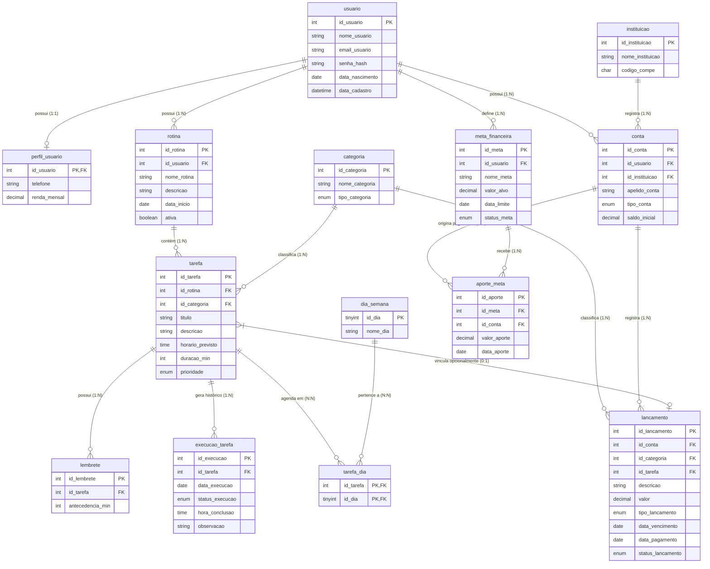

[documenta_o_do_banco_de_dados_rotior.md](https://github.com/user-attachments/files/34368133/documenta_o_do_banco_de_dados_rotior.md)[Uploading doc# 📌 Banco de Dados Rotior

O **Rotior** é um sistema integrativo de gestão pessoal que combina planejamento de rotinas/tarefas e controle financeiro. O banco de dados foi modelado no MySQL Workbench e estrutura relacionamentos entre usuários, hábitos/tarefas diárias, contas bancárias e lançamentos financeiros.

---

## 📂 Estrutura de Arquivos

Abaixo está a estrutura organizada e limpa dos scripts SQL contidos no pacote (desconsiderando arquivos duplicados de backup):

```text
atividadeIII/
├── rotior_usuario.sql           # Cadastro principal de usuários
├── rotior_perfil_usuario.sql    # Informações complementares (Telefone, Renda)
├── rotior_instituicao.sql       # Instituições financeiras (Bancos/Corretoras)
├── rotior_conta.sql             # Contas bancárias dos usuários
├── rotior_dia_semana.sql        # Tabela domínio com os dias da semana
├── rotior_categoria.sql         # Categoria unificada (Tarefa, Receita, Despesa)
├── rotior_rotina.sql            # Rotinas vinculadas aos usuários
├── rotior_tarefa.sql            # Tarefas pertencentes a uma rotina
├── rotior_tarefa_dia.sql        # Associação de tarefas aos dias da semana (N:N)
├── rotior_lembrete.sql          # Alertas e notificações de antecedência
├── rotior_execucao_tarefa.sql   # Histórico diário e status de execução das tarefas
├── rotior_lancamento.sql        # Movimentações financeiras (Receitas/Despesas)
├── rotior_meta_financeira.sql   # Metas e objetivos financeiros
└── rotior_aporte_meta.sql       # Histórico de depósitos para metas
```

---

## ⚙️ Informações Técnicas e Conceitos

- **SGBD:** MySQL 8.0.46 (gerado via MySQL Workbench)
- **Nome do Banco de Dados:** `rotior`
- **Credenciais Padrão (Ambiente Local):** `root` / `root`

### Glossário Técnico Simplificado
- **Engine (`InnoDB`):** Mecanismo de armazenamento padrão do MySQL. Oferece suporte a Transações (ACID) e garante a integridade dos dados por meio de Chaves Estrangeiras (Foreign Keys).
- **Charset (`utf8mb4`):** Codificação de caracteres universais de 4 bytes. Suporta todos os caracteres da língua portuguesa (acentuação e cedilha) e símbolos/emojis.
- **Collation (`utf8mb4_0900_ai_ci`):** Regras de comparação de texto:
  - `ai` (*Accent Insensitive*): Ignora acentos na comparação (ex: `"saúde"` é igual a `"saude"`).
  - `ci` (*Case Insensitive*): Ignora diferença entre maiúsculas e minúsculas (ex: `"aluguel"` é igual a `"ALUGUEL"`).

---

## 📐 Diagrama Entidade-Relacionamento (Mermaid)



---

## 📚 Dicionário do Modelo de Dados

### 1. Módulo de Usuários
| Tabela | Descrição | Principais Chaves e Atributos |
| :--- | :--- | :--- |
| `usuario` | Cadastro principal | `id_usuario` (PK), `nome_usuario`, `email_usuario` (ÚNICO), `senha_hash` |
| `perfil_usuario` | Detalhes adicionais (1:1) | `id_usuario` (PK, FK `usuario.id_usuario` ON DELETE CASCADE), `telefone`, `renda_mensal` |

### 2. Módulo de Rotinas e Hábitos
| Tabela | Descrição | Principais Chaves e Atributos |
| :--- | :--- | :--- |
| `rotina` | Agrupador de hábitos | `id_rotina` (PK), `id_usuario` (FK), `nome_rotina`, `ativa` (BOOLEAN) |
| `categoria` | Domínio de categorias | `id_categoria` (PK), `nome_categoria`, `tipo_categoria` (`TAREFA`, `RECEITA`, `DESPESA`) |
| `tarefa` | Atividades da rotina | `id_tarefa` (PK), `id_rotina` (FK), `id_categoria` (FK), `prioridade` (`BAIXA`, `MEDIA`, `ALTA`) |
| `tarefa_dia` | Vínculo semanal (N:N) | (`id_tarefa`, `id_dia`) (PK), `id_dia` (FK `dia_semana`) |
| `lembrete` | Configuração de alertas | `id_lembrete` (PK), `id_tarefa` (FK), `antecedencia_min` |
| `execucao_tarefa` | Histórico real | `id_execucao` (PK), `id_tarefa` (FK), `status_execucao` (`PENDENTE`, `CONCLUIDA`, `ADIADA`, `CANCELADA`) |

### 3. Módulo Financeiro
| Tabela | Descrição | Principais Chaves e Atributos |
| :--- | :--- | :--- |
| `instituicao` | Bancos/Corretoras | `id_instituicao` (PK), `nome_instituicao`, `codigo_compe` |
| `conta` | Contas bancárias | `id_conta` (PK), `id_usuario` (FK), `id_instituicao` (FK), `tipo_conta` (`CORRENTE`, `POUPANCA`, `CARTEIRA`, `INVESTIMENTO`) |
| `lancamento` | Movimentações financeiras | `id_lancamento` (PK), `id_conta` (FK), `id_categoria` (FK), `id_tarefa` (FK Anulável), `tipo_lancamento` (`RECEITA`, `DESPESA`), `status_lancamento` (`PENDENTE`, `PAGO`, `ATRASADO`) |
| `meta_financeira` | Objetivos | `id_meta` (PK), `id_usuario` (FK), `valor_alvo`, `status_meta` (`ATIVA`, `CONCLUIDA`, `CANCELADA`) |
| `aporte_meta` | Depósitos para metas | `id_aporte` (PK), `id_meta` (FK), `id_conta` (FK), `valor_aporte` |

---

## 🚀 Guia de Instalação e Execução

### 1. Criar o Banco de Dados
Conecte-se ao MySQL e execute:

```sql
CREATE DATABASE IF NOT EXISTS rotior
CHARACTER SET utf8mb4
COLLATE utf8mb4_0900_ai_ci;

USE rotior;
```

### 2. Ordem Sequencial de Importação (Devido às Foreign Keys)
Execute os arquivos na seguinte ordem rigorosa para evitar erros de restrição de chave estrangeira:

1. `rotior_usuario.sql`
2. `rotior_perfil_usuario.sql`
3. `rotior_instituicao.sql`
4. `rotior_conta.sql`
5. `rotior_dia_semana.sql`
6. `rotior_categoria.sql`
7. `rotior_rotina.sql`
8. `rotior_tarefa.sql`
9. `rotior_tarefa_dia.sql`
10. `rotior_lembrete.sql`
11. `rotior_execucao_tarefa.sql`
12. `rotior_lancamento.sql`
13. `rotior_meta_financeira.sql`
14. `rotior_aporte_meta.sql`

### 💡 Dica de Automação de Importação
Você pode concatenar e executar em lote via terminal:

- **Windows (PowerShell):**
  ```powershell
  Get-Content rotior_*.sql | mysql -u root -proot rotior
  ```

- **Linux/macOS (Bash):**
  ```bash
  cat rotior_*.sql | mysql -u root -proot rotior
  ```

---

## 🔍 Consultas Úteis para Teste (DML)

### 1. Listar tarefas ativas de cada usuário com horário e prioridade
```sql
SELECT 
    u.nome_usuario,
    r.nome_rotina,
    t.titulo AS tarefa,
    t.horario_previsto,
    t.prioridade,
    c.nome_categoria
FROM usuario u
INNER JOIN rotina r ON u.id_usuario = r.id_usuario
INNER JOIN tarefa t ON r.id_rotina = t.id_rotina
INNER JOIN categoria c ON t.id_categoria = c.id_categoria
WHERE r.ativa = 1
ORDER BY u.nome_usuario, t.horario_previsto;
```

### 2. Extrato financeiro detalhado por conta
```sql
SELECT 
    u.nome_usuario,
    c.apelido_conta,
    cat.nome_categoria,
    l.descricao,
    l.valor,
    l.tipo_lancamento,
    l.status_lancamento,
    l.data_vencimento
FROM lancamento l
INNER JOIN conta c ON l.id_conta = c.id_conta
INNER JOIN usuario u ON c.id_usuario = u.id_usuario
INNER JOIN categoria cat ON l.id_categoria = cat.id_categoria
ORDER BY l.data_vencimento DESC;
```umenta_o_do_banco_de_dados_rotior.md…]()


### Link das documentações

[RotinOr_Documentacao.docx](https://github.com/user-attachments/files/34271432/RotinOr_Documentacao.docx)

[documenta_o_do_banco_de_dados_rotior.md](https://github.com/user-attachments/files/34271225/documenta_o_do_banco_de_dados_rotior.md)

